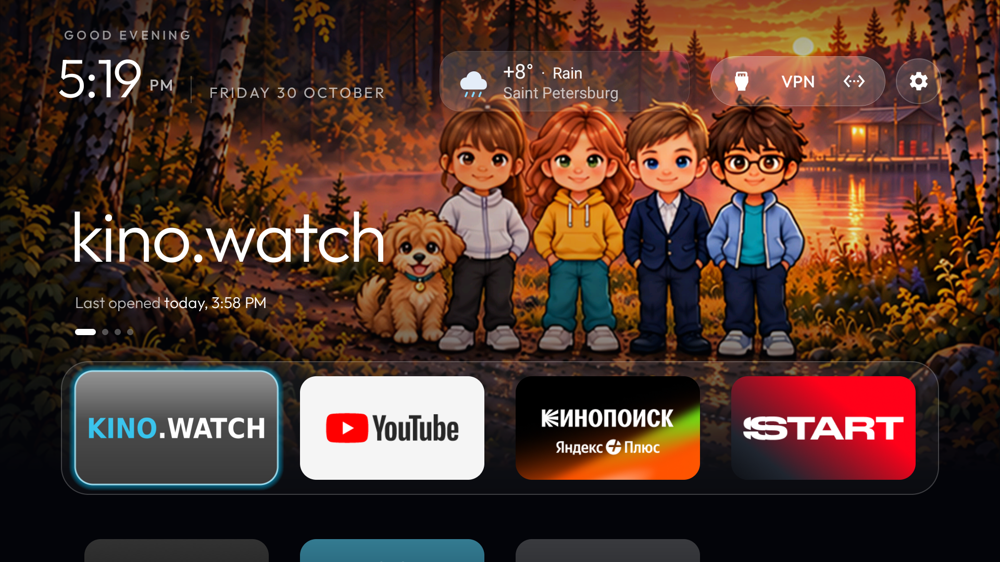
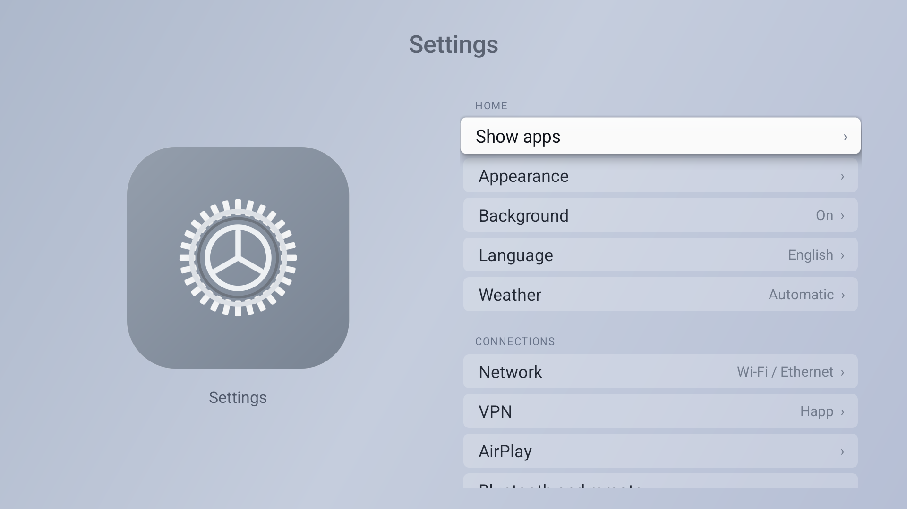
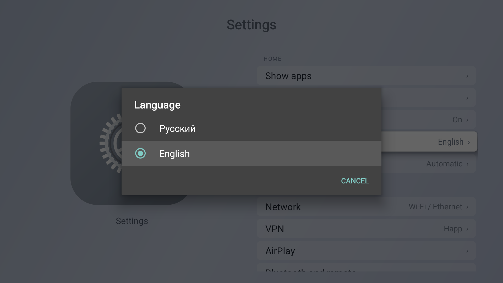
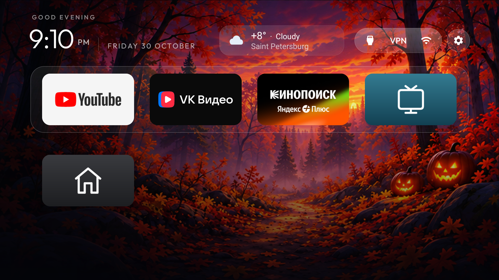

# TV Home Launcher

[English](README.md) | [Русский](README.ru.md)

A lightweight Android TV / Google TV home launcher with an Apple TV-inspired interface.

**Portable build: 3.5-portable5.** Requires Android 8.0 or later. This is a launcher app, not Android or tvOS firmware. The launcher interface and documentation are available in English and Russian.

## Download and install

- [Download the APK](downloads/TV-Home-Apple-Style.apk?raw=1)
- [Installation guide](docs/INSTALL.en.md)
- [SHA-256 checksum](downloads/SHA256.txt)

Copy the APK to a USB drive, open it with a file manager on the TV, and install it. Then select “Главный экран” (Home) as the default Home app if the firmware supports this. Some models require a separate, model-specific setup to change the default launcher.

Streaming apps, accounts, VPN subscriptions and an AirPlay receiver are not bundled. The launcher does not automatically disable system apps.

## Features

- Four large first-row tiles: kino.watch, YouTube, Kinopoisk and START; other installed TV apps appear below.
- English and Russian: **Settings → Language → Русский / English**. The choice survives app updates; the TV’s native settings keep their system language.
- Automatic discovery of newly installed TV apps and control over tile visibility.
- Inputs, VPN and network controls in a shared top capsule, with a separate settings button.
- A TV tile for the built-in tuner and custom labels for physical HDMI ports.
- A light settings menu with links to native Bluetooth, network, picture and sound settings.
- Seven bundled background themes, an On/Off switch and four times of day; all 28 images are 3840×2160. [Themes and UI resolution](docs/BACKGROUNDS.en.md).
- Weather with approximate city detection and automatic text sizing for longer city names.
- A restart shortcut that navigates to the native settings menu. The user confirms the actual restart.

The VPN button opens Happ, which must be installed separately. The TV’s original screensaver and its timers are not changed automatically.

## Screenshots

Actual captures from the main 3.4 build on a Xiaomi MiTV-MOEU1. The portable build uses the same interface with an embedded theme. English is shown below; Russian captures are in the Russian README.

**Home screen**

**Settings**

**Language selection**

**Inputs**

## Background themes

[Gallery and background controls](docs/BACKGROUNDS.en.md): forest/lake, mountains, coast, paradise beach, New Year, Halloween forest and After the Bell with Johnny beside Maria. Implemented in APK 3.4; open **Settings → Background**.

Enabled state, theme and time mode are saved. Automatic follows the TV clock; Off restores the previous appearance. All 28 files are 3840×2160 upscaled approved illustrations. The tested Xiaomi firmware limits the actual UI to 1920×1080.

**Paradise beach — actual TV capture**

**After the Bell at night — Johnny beside Maria**

**Wallpaper and time-of-day controls**

## Tested TVs

| Model | System | Status |
| --- | --- | --- |
| Xiaomi Mini LED 55 2025, MiTV-MOEU1 (lalaland) | Android TV 14 / API 34 | Core functions checked in main 3.2; RU/EN switching and persistence and backgrounds checked in 3.4; TV/Home movement checked in 3.5 |
| KIVI 4K Android TV (bangbae) | Android 11 / API 30 | Portable 3.5: installation, Home after reboot, RU/EN, backgrounds, TV/Home movement, Bluetooth and inputs |
| Other Android TV / Google TV models | Declared minimum: Android 8 / API 26 | Installation and operation have not been tested on real devices yet |

**Build distinction:** Xiaomi uses the main build, including TV/Home movement checks in 3.5. KIVI was installed and tested with this repository’s portable 3.5-portable5 APK. Testing these two devices does not establish compatibility with every Android TV model.

See [TESTED_TVS.en.md](docs/TESTED_TVS.en.md) for actual checks and limitations.

## Weather and permissions

Weather requests start only after consent in the interface. IPWhois receives the public IP address to estimate the city. Open-Meteo and the fallback provider wttr.in receive an approximate location and can see request network metadata. GPS is not used. A VPN may change the detected city. Weather can be disabled.

Automatic navigation to the restart menu requires separately enabling “System menu helper” (“Помощник системного меню” in Russian) in Android Accessibility settings. Android grants this service access to screen content and menu control. The implementation acts only after the restart shortcut is pressed, only inside native settings, and for up to 20 seconds. It does not intercept remote keys or press the restart confirmation. Remote navigation commands are supported on Android 13+. Native menu labels and layout depend on the firmware.

AirPlay availability, VPN connectivity and playback in third-party players are separate TV or app functions, not provided by the launcher itself.

## Source and building

`app/src` contains the portable build’s source and JVM tests. Building requires JDK 17 and Android SDK 34. Commands and signing details: [BUILD.en.md](docs/BUILD.en.md).

Current build validation: 315 JVM tests passed, Android lint reported 0 errors and 101 warnings, and the release APK was built successfully. These are automated code checks, not testing on additional TV models.

## Upstream and licenses

Adapted from [Gathin23/cleanyourtv](https://github.com/Gathin23/cleanyourtv), base commit `095b71ad93d99ea28d94d97b06385709d354b795`.

- [MIT license and original notice](LICENSE)
- [Outfit font license](FONT-LICENSE-OFL.txt)
- [Upstream notices](NOTICE.md)

This project is not affiliated with Apple, Xiaomi or the developers of the third-party apps shown in the interface.

## KIVI: actual device captures

The portable build on a KIVI 4K Android TV running Android 11. These UI captures are 1920×1080; wallpaper files are 3840×2160.

## Arrange tiles and restore the original Home

Hold OK on a tile or press Menu, choose Move, use the arrows, press OK to place it, and Back to save. TV and Home can move alongside applications and remain available in the launcher; their menus do not offer removal.

For the tested KIVI, use the [recovery script](tools/Restore-Kivi.ps1) and [recovery guide](docs/RESTORE_KIVI.en.md). Restore only the original Home or all 15 packages from the separate cleanup profile while preserving their data. The APK itself does not disable packages.
