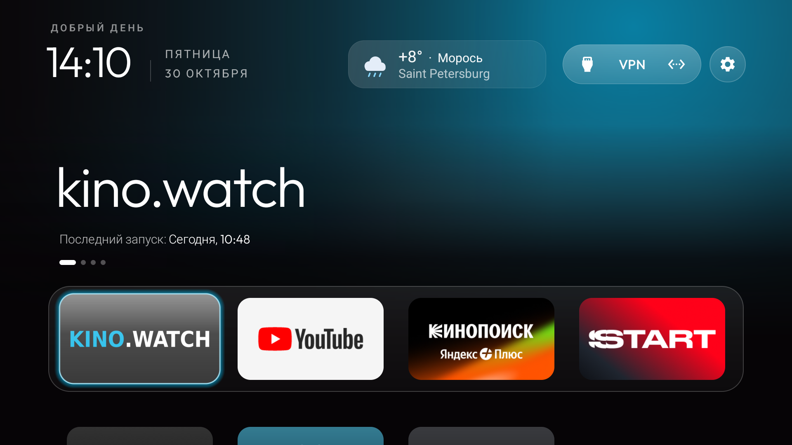
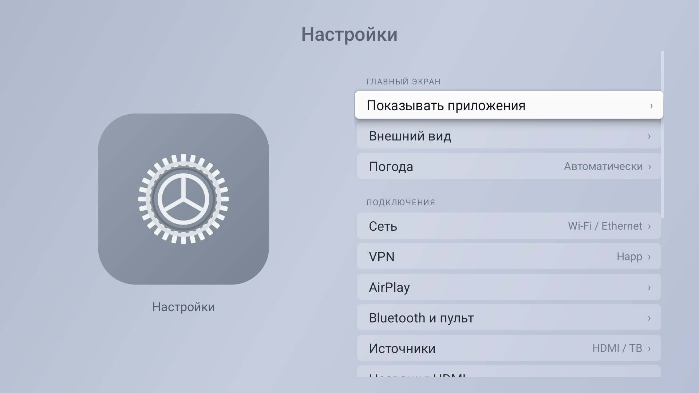
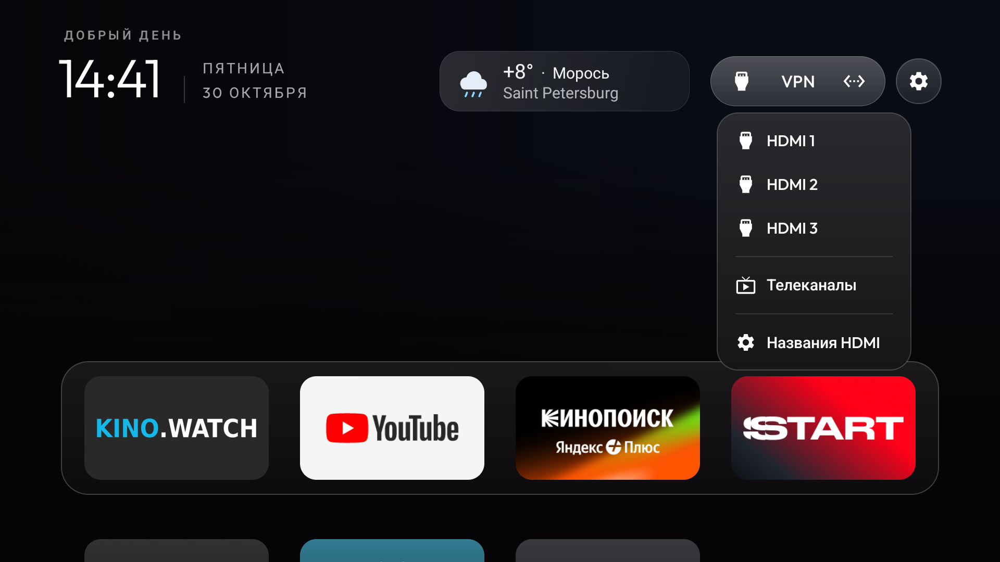

# TV Home Launcher

Лёгкий главный экран для Android TV / Google TV с оформлением в стиле Apple TV.

**Переносная сборка: 3.2-portable2.** Требуется Android 8.0 или новее. Это приложение-лаунчер, а не прошивка Android или tvOS.

## Скачать и установить

- [Установочный APK](downloads/TV-Home-Apple-Style.apk?raw=1)
- [Инструкция](docs/INSTALL.ru.txt)
- [Контрольная сумма SHA-256](downloads/SHA256.txt)

Скопируйте APK на флешку, откройте файловым менеджером на телевизоре и установите. Затем назначьте «Главный экран» приложением Home по умолчанию, если прошивка позволяет. На некоторых моделях для назначения Home нужна отдельная настройка под конкретный телевизор.

Приложения, аккаунты, VPN-подписки и AirPlay-приёмник в APK не входят. Лаунчер не отключает системные приложения автоматически.

## Возможности

- Четыре крупные плитки первого ряда: kino.watch, YouTube, Кинопоиск и START; ниже остальные установленные TV-приложения.
- Автоматическое появление новых TV-приложений и настройка видимости плиток.
- Источники сигнала, VPN и сеть в общем верхнем овале; отдельная кнопка настроек.
- Плитка ТВ для встроенного тюнера и свои названия физических HDMI-входов.
- Светлое меню настроек; переходы в штатные настройки Bluetooth, сети, изображения и звука.
- Бесплатная погода с приблизительным определением города и подгонкой длинного названия под карточку.
- Кнопка перезагрузки с переходом в штатное меню. Перезапуск подтверждает пользователь.

VPN-кнопка открывает отдельно установленный Happ. Встроенная заставка телевизора и её таймеры автоматически не меняются.

## Скриншоты

Снимки основной сборки 3.2 на Xiaomi MiTV-MOEU1. У переносной сборки тот же интерфейс со встроенной темой.

**Главный экран**

**Настройки**

**Источники сигнала**

## На каких телевизорах проверено

| Модель | Система | Статус |
| --- | --- | --- |
| Xiaomi Mini LED 55 2025, MiTV-MOEU1 (lalaland) | Android TV 14 / API 34 | Интерфейс и основные функции проверены в основной сборке 3.2; подробности ниже |
| Другие Android TV / Google TV | Заявленный минимум Android 8 / API 26 | Реальная установка и работа пока не проверены |

**Различие сборок:** проверки на Xiaomi проводились основной сборкой 3.2. Переносной APK 3.2-portable2 из этого репозитория собран отдельно, со встроенной темой и домиком. Его установка на втором телевизоре ещё не проверена. Минимальная версия Android в манифесте не означает, что испытаны все модели.

Список реальных проверок и ограничений: [TESTED_TVS.md](docs/TESTED_TVS.md).

## Погода и разрешения

Погода включается только после согласия в интерфейсе. IPWhois получает внешний IP для приблизительного города; Open-Meteo и резервный wttr.in получают приблизительное местоположение и видят сетевые метаданные запроса. GPS не используется. При VPN определённый город может отличаться. Погоду можно отключить.

Для автоматического перехода к системной перезагрузке отдельно разрешается «Помощник системного меню» в специальных возможностях Android. Android предоставляет ему доступ к содержимому экрана и управлению меню. Реализация действует только после нажатия кнопки, только в штатных настройках, до 20 секунд; она не перехватывает клавиши и не нажимает подтверждение перезагрузки. Точная навигация командами пульта предусмотрена для Android 13+. Размещение и названия системных пунктов зависят от прошивки.

Наличие AirPlay, качество VPN и работа сторонних плееров этим лаунчером не обеспечиваются: это отдельные функции телевизора и установленных приложений.

## Исходники и сборка

В `app/src` находятся исходники переносной сборки и JVM-тесты. Для сборки нужны JDK 17 и Android SDK 34. Команды и особенности подписи: [BUILD.md](docs/BUILD.md).

Проверка текущей сборки: 307 JVM-тестов пройдены, Android lint — 0 ошибок и 99 предупреждений, release APK собран. Это автоматические проверки кода, а не испытания на дополнительных телевизорах.

## Основа и лицензии

Адаптация [Gathin23/cleanyourtv](https://github.com/Gathin23/cleanyourtv), исходная база `095b71ad93d99ea28d94d97b06385709d354b795`.

- [MIT License и исходное уведомление](LICENSE)
- [Лицензия шрифта Outfit](FONT-LICENSE-OFL.txt)
- [Уведомления об исходном проекте](NOTICE.md)

Проект не связан с Apple, Xiaomi или разработчиками показываемых сторонних приложений.
