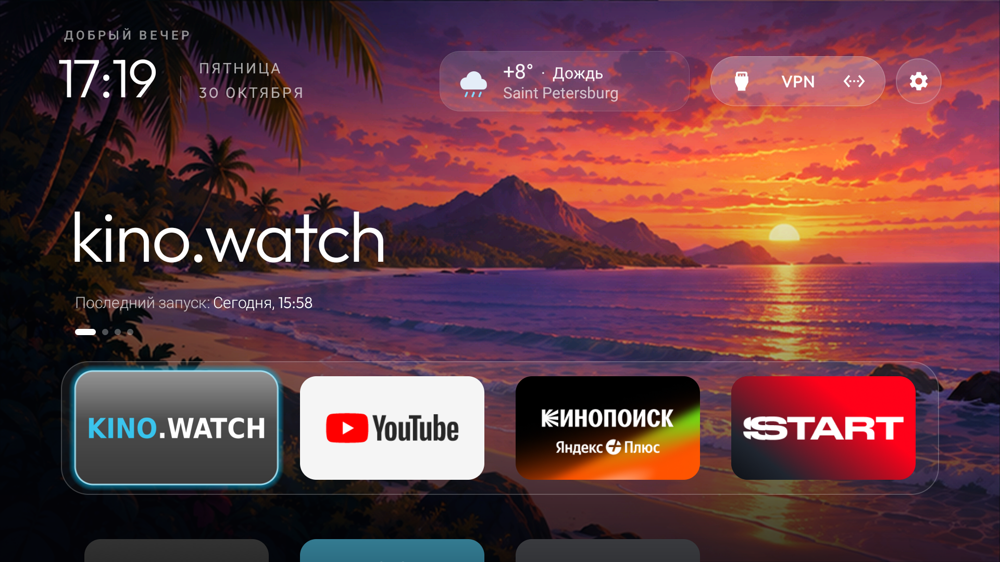
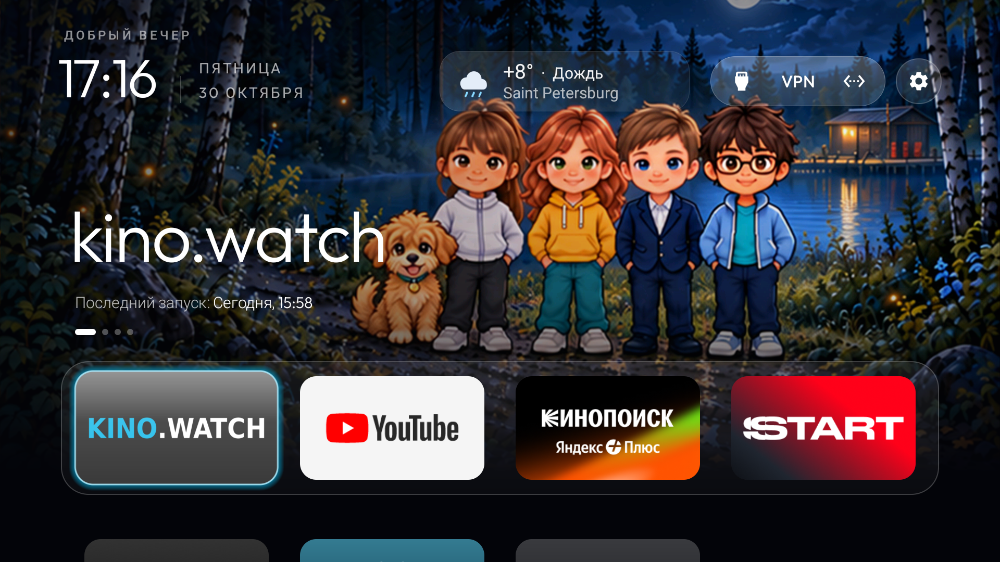
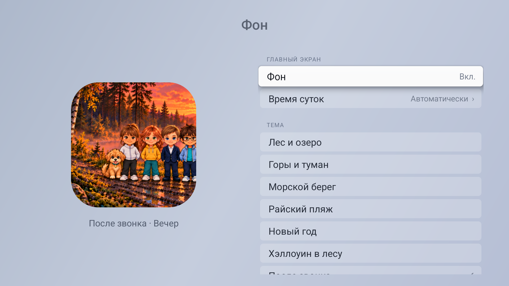
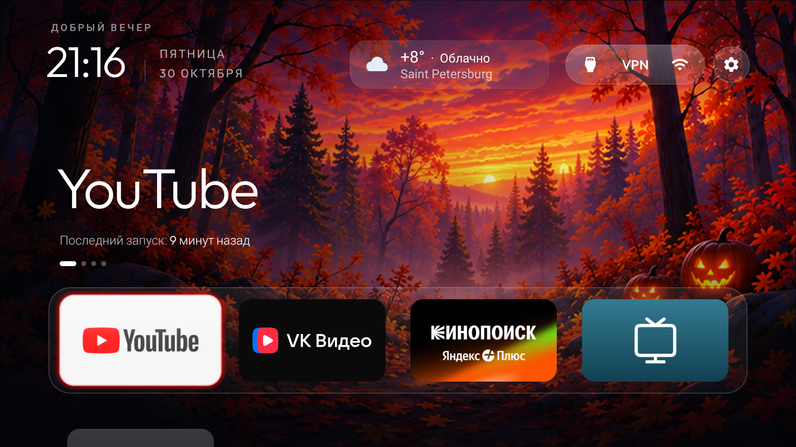

# TV Home Launcher

[Русский](README.ru.md) | [English](README.md)

Лёгкий главный экран для Android TV / Google TV с оформлением в стиле Apple TV.

**Переносная сборка: 3.5-portable5.** Требуется Android 8.0 или новее. Это приложение-лаунчер, а не прошивка Android или tvOS.

## Скачать и установить

- [Установочный APK](https://raw.githubusercontent.com/SlayerApp/tv-home-launcher/main/downloads/TV-Home-Apple-Style.apk)
- [Инструкция](docs/INSTALL.ru.txt)
- [Контрольная сумма SHA-256](downloads/SHA256.txt)

Скопируйте APK на флешку, откройте файловым менеджером на телевизоре и установите. Затем назначьте «Главный экран» приложением Home по умолчанию, если прошивка позволяет. На некоторых моделях для назначения Home нужна отдельная настройка под конкретный телевизор.

Приложения, аккаунты, VPN-подписки и AirPlay-приёмник в APK не входят. Лаунчер не отключает системные приложения автоматически.

## Возможности

- Четыре крупные плитки первого ряда: kino.watch, YouTube, Кинопоиск и START; ниже остальные установленные TV-приложения.
- Русский и английский языки: **Настройки → Язык → Русский / English**. Выбор сохраняется после обновления приложения; язык системных меню ТВ не меняется.
- Автоматическое появление новых TV-приложений и настройка видимости плиток.
- Источники сигнала, VPN и сеть в общем верхнем овале; отдельная кнопка настроек.
- Плитка ТВ для встроенного тюнера и свои названия физических HDMI-входов.
- Светлое меню настроек; переходы в штатные настройки Bluetooth, сети, изображения и звука.
- Семь встроенных тем фона с переключателем Вкл./Выкл. и четырьмя временами суток; все 28 изображений — 3840×2160. [Темы и разрешение интерфейса](docs/BACKGROUNDS.md).
- Бесплатная погода с приблизительным определением города и подгонкой длинного названия под карточку.
- Кнопка перезагрузки с переходом в штатное меню. Перезапуск подтверждает пользователь.

VPN-кнопка открывает отдельно установленный Happ. Встроенная заставка телевизора и её таймеры автоматически не меняются.

## Скриншоты

Реальные снимки основной сборки 3.4 на Xiaomi MiTV-MOEU1. У переносной сборки тот же интерфейс со встроенной темой.

**Главный экран**

**Настройки**

**Источники сигнала**

## Темы фона

[Галерея и управление фонами](docs/BACKGROUNDS.md): лес и озеро, горы, морской берег, райский пляж, Новый год, лесной Хэллоуин и «После звонка» с Джонни рядом с Марией. Функция включена в APK 3.4; выберите **Настройки → Фон**.

Включение, тема и время суток сохраняются. Автоматический режим следует часам ТВ; Выкл. возвращает прежнее оформление. Все 28 файлов имеют размер 3840×2160 — это увеличенные согласованные иллюстрации. На проверенном Xiaomi прошивка ограничивает сам интерфейс до 1920×1080.

**Райский пляж — снимок с ТВ**

**Ночная тема «После звонка» — Джонни рядом с Марией**

**Выбор обоев и времени суток**

## На каких телевизорах проверено

| Модель | Система | Статус |
| --- | --- | --- |
| Xiaomi Mini LED 55 2025, MiTV-MOEU1 (lalaland) | Android TV 14 / API 34 | Основные функции проверены в 3.2; переключение RU/EN и сохранение выбора и фоны — в 3.4; перемещение ТВ/домика — в 3.5 |
| KIVI 4K Android TV (bangbae) | Android 11 / API 30 | Переносной APK 3.5: установка, Home после перезагрузки, RU/EN, фоны, перемещение ТВ/домика, Bluetooth и источники |
| Другие Android TV / Google TV | Заявленный минимум Android 8 / API 26 | Реальная установка и работа пока не проверены |

**Различие сборок:** на Xiaomi использована основная сборка, включая проверку перемещения ТВ/домика в 3.5. На KIVI установлен и проверен переносной APK 3.5-portable5 из этого репозитория. Проверка этих двух устройств не означает совместимость со всеми моделями Android TV.

Список реальных проверок и ограничений: [TESTED_TVS.md](docs/TESTED_TVS.md).

## Погода и разрешения

Погода включается только после согласия в интерфейсе. IPWhois получает внешний IP для приблизительного города; Open-Meteo и резервный wttr.in получают приблизительное местоположение и видят сетевые метаданные запроса. GPS не используется. При VPN определённый город может отличаться. Погоду можно отключить.

Для автоматического перехода к системной перезагрузке отдельно разрешается «Помощник системного меню» в специальных возможностях Android. Android предоставляет ему доступ к содержимому экрана и управлению меню. Реализация действует только после нажатия кнопки, только в штатных настройках, до 20 секунд; она не перехватывает клавиши и не нажимает подтверждение перезагрузки. Точная навигация командами пульта предусмотрена для Android 13+. Размещение и названия системных пунктов зависят от прошивки.

Наличие AirPlay, качество VPN и работа сторонних плееров этим лаунчером не обеспечиваются: это отдельные функции телевизора и установленных приложений.

## Исходники и сборка

В `app/src` находятся исходники переносной сборки и JVM-тесты. Для сборки нужны JDK 17 и Android SDK 34. Команды и особенности подписи: [BUILD.md](docs/BUILD.md).

Проверка текущей сборки: 315 JVM-тестов пройдены, Android lint — 0 ошибок и 101 предупреждение, release APK собран. Это автоматические проверки кода, а не испытания на дополнительных телевизорах.

## Основа и лицензии

Адаптация [Gathin23/cleanyourtv](https://github.com/Gathin23/cleanyourtv), исходная база `095b71ad93d99ea28d94d97b06385709d354b795`.

- [MIT License и исходное уведомление](LICENSE)
- [Лицензия шрифта Outfit](FONT-LICENSE-OFL.txt)
- [Уведомления об исходном проекте](NOTICE.md)

Проект не связан с Apple, Xiaomi или разработчиками показываемых сторонних приложений.

## KIVI: реальные снимки

Переносная сборка на KIVI 4K Android TV, Android 11. Снимки интерфейса 1920×1080; файлы обоев — 3840×2160.

## Перемещение плиток и возврат штатного меню

Удерживайте OK на плитке или нажмите Menu, выберите «Переместить», перемещайте стрелками, нажмите OK для размещения и Back для сохранения. ТВ и домик перемещаются вместе с приложениями; их скрытие и удаление через меню лаунчера недоступны.

Для проверенного KIVI подготовлены [файл восстановления](tools/Restore-Kivi.ps1) и [инструкция возврата штатного меню](docs/RESTORE_KIVI.md). Можно вернуть только старый Home либо все 15 пакетов из отдельного профиля очистки, сохранив данные. Сам APK не отключает пакеты.
