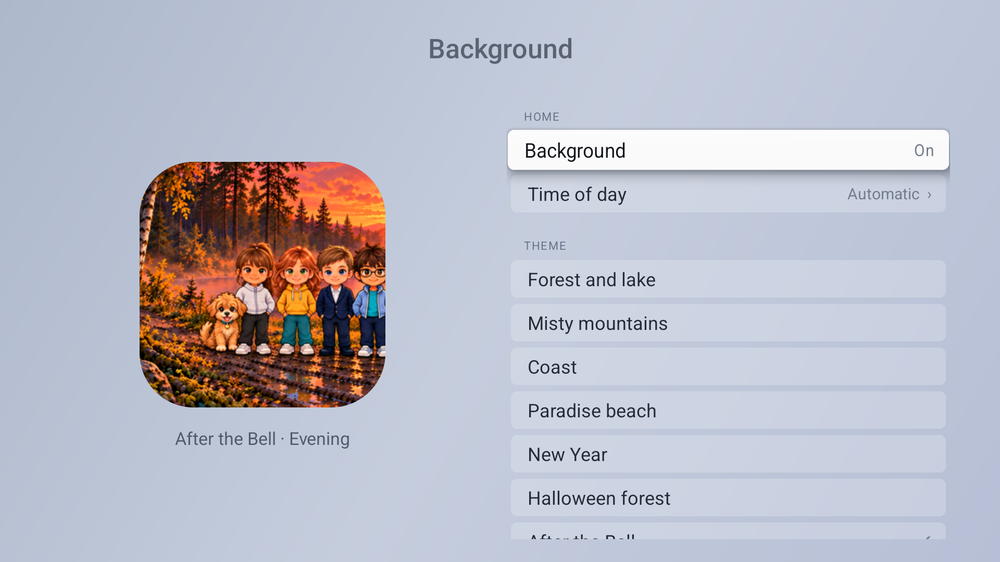
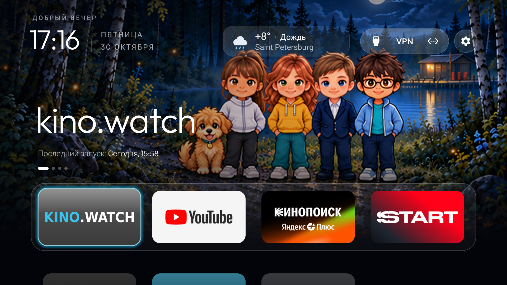
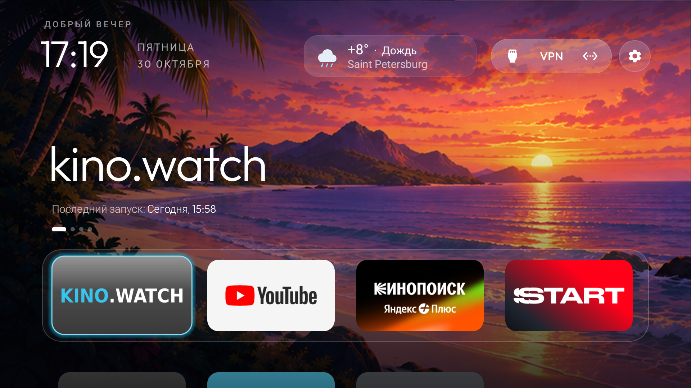
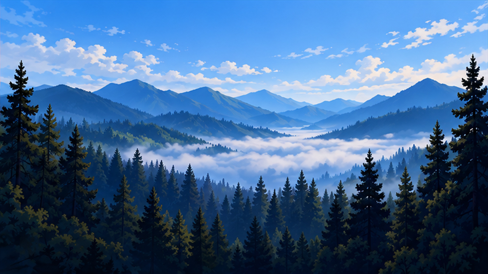
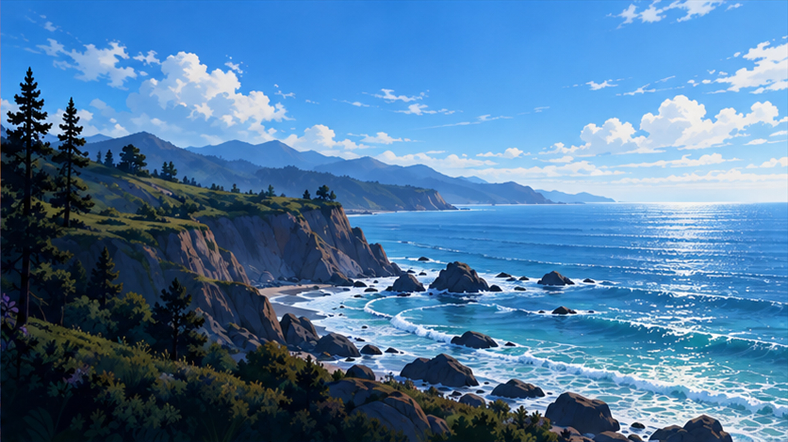
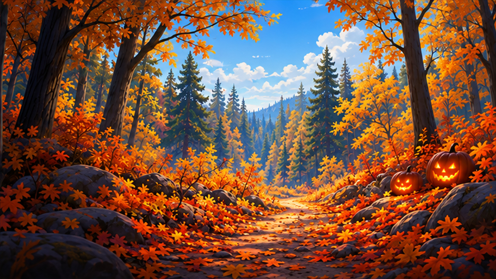
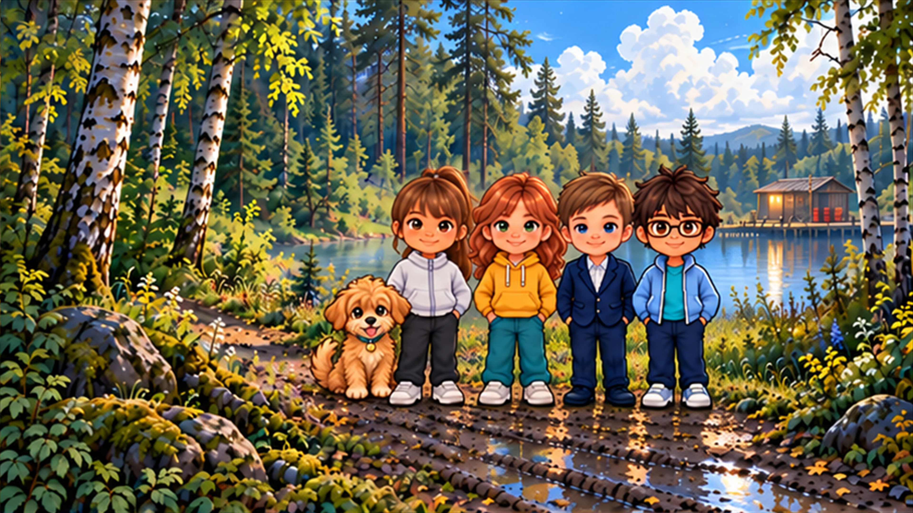

# Background themes

[English](BACKGROUNDS.en.md) | [Русский](BACKGROUNDS.md)

Implemented in version 3.4. Open **Settings → Background**. On enables the selected scene; Off restores the previous Home appearance. Choices persist through app updates. New installations start with Background Off. The standby screensaver and tile positions are kept.

**Time of day:** Automatic follows the TV’s local clock: morning 06–11, day 11–17, evening 17–22, night 22–06. You can also select a fixed time. No network or location permission is needed.

## Resolution

All 28 installed wallpaper files are 3840×2160 JPEG. These are high-quality upscales of the approved generated illustrations, not newly synthesized native-4K detail. The app samples them for the available viewport, preserving layout on 1080p and using the larger bitmap when Android exposes a 4K viewport.

On the tested MiTV-MOEU1, the panel runs at 3840×2160 with a 1920×1080 app viewport. `config_maxUiWidth` was 1920 in the original test and 3840 in the follow-up, while the effective viewport remained 1920×1080 with the system size override in place. Native 4K UI remains unverified on this TV. [How Android calculates the UI dimensions](https://android.googlesource.com/platform/frameworks/base/+/e0f778e6a0d7/services/core/java/com/android/server/wm/DisplayContent.java)

## Xiaomi UI appears enlarged after a restart

On a Xiaomi MiTV-MOEU1 (`lalaland`), the app viewport stayed at 1920×1080 after restart, but the UI density rose from 320 to 640 dpi. Restoring 320 dpi restored the original scale without changing either resolution. The model-specific steps below use ADB bundled with the Windows installer.

1. Connect the TV in the installer. Open PowerShell. Replace the example address and port with the TV's own address and port.

   ```powershell
   $adb = Join-Path $env:LOCALAPPDATA 'TVHomeInstaller\adb-37.0.1\adb.exe'
   $tv = '192.168.1.50:5555'
   & $adb -s $tv shell getprop ro.product.model
   & $adb -s $tv shell am get-current-user
   & $adb -s $tv shell wm size
   & $adb -s $tv shell wm density
   ```

2. Run the following commands only if the TV matches the observed case: `MiTV-MOEU1`, user `0`, physical size `3840x2160`, override size `1920x1080`, physical density `320` and override density `640`.

   ```powershell
   & $adb -s $tv shell wm density 320
   & $adb -s $tv shell settings --user 0 put secure display_density_forced 320
   & $adb -s $tv shell wm density
   & $adb -s $tv shell settings --user 0 get secure display_density_forced
   ```

The scale updates immediately. The last command should return `320`. Both the live and stored values were verified. The stored value has yet to be tested on a subsequent restart. [How Android reads stored display density](https://android.googlesource.com/platform/frameworks/base/+/android-14.0.0_r1/services/core/java/com/android/server/wm/WindowManagerService.java)

## Actual TV captures







## The seven scenes

Daytime examples below link to the actual 4K files. Each theme also has morning, evening and night files in `app/src/main/assets/backgrounds`.

### Forest and lake


### Misty mountains



### Coast



### Paradise beach


### New Year


### Halloween forest



### After the Bell — Johnny beside Maria



Game character references: [After the Bell](https://afterthebellgame.com/), [App Store](https://apps.apple.com/ru/app/id6822703005).

[Generation prompt set](background-production-prompts.json).
