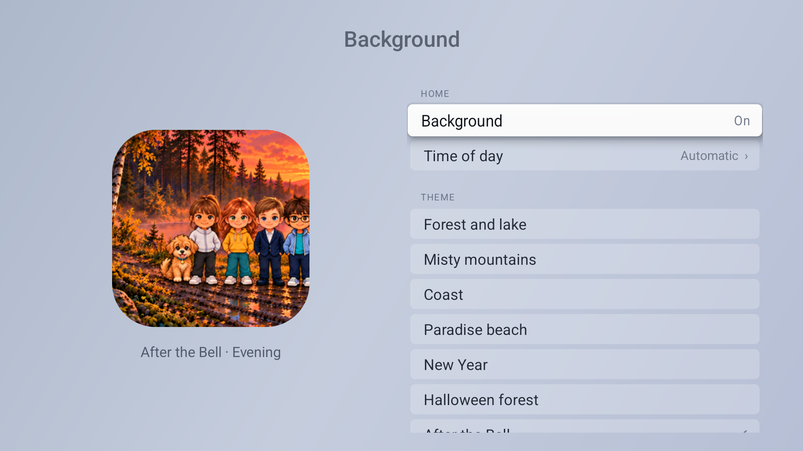
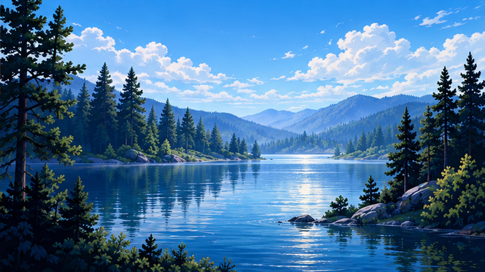
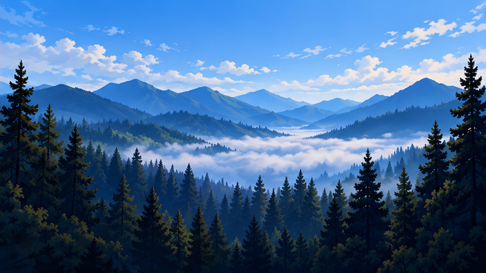
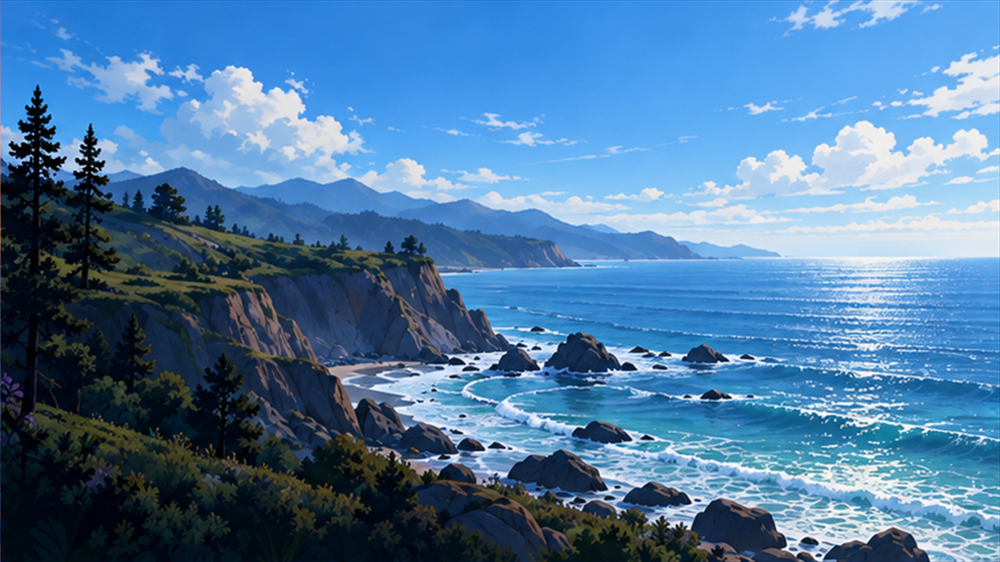
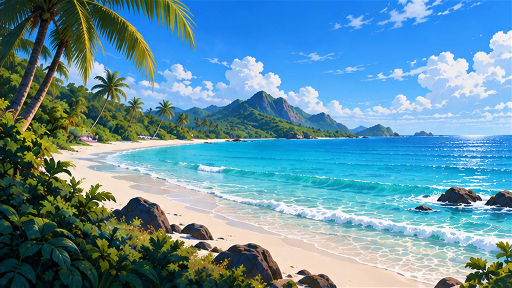
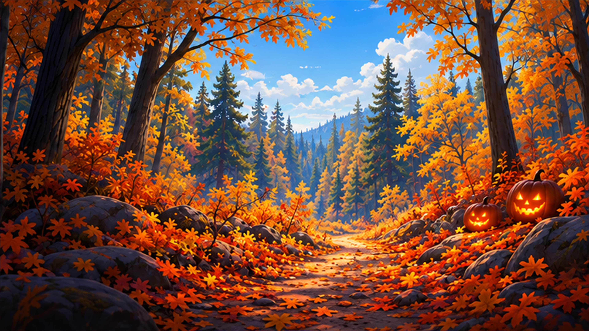
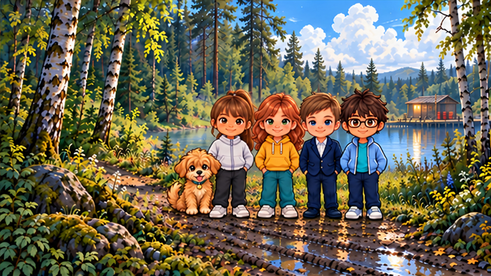

# Background themes

[English](BACKGROUNDS.en.md) | [Русский](BACKGROUNDS.md)

Implemented in version 3.4. Open **Settings → Background**. On enables the selected scene; Off restores the previous Home appearance. Choices persist through app updates. New installations start with Background Off. The standby screensaver and tile positions are kept.

**Time of day:** Automatic follows the TV’s local clock: morning 06–11, day 11–17, evening 17–22, night 22–06. You can also select a fixed time. No network or location permission is needed.

## Resolution

All 28 installed wallpaper files are 3840×2160 JPEG. These are high-quality upscales of the approved generated illustrations, not newly synthesized native-4K detail. The app samples them for the available viewport, preserving layout on 1080p and using the larger bitmap when Android exposes a 4K viewport.

On the tested MiTV-MOEU1, Android reports a 3840×2160 panel but a 1920×1080 app viewport. Firmware resource `config_maxUiWidth=1920` was read directly; both resetting the size and requesting 3840×2160 kept 1080p. Native 4K UI was therefore not achieved on this firmware. A real 4K UI on another TV is not yet tested. Android applies this maximum in [DisplayContent](https://android.googlesource.com/platform/frameworks/base/+/e0f778e6a0d7/services/core/java/com/android/server/wm/DisplayContent.java). No root or firmware changes were used.

## Actual TV captures

## The seven scenes

Daytime examples below link to the actual 4K files. Each theme also has morning, evening and night files in `app/src/main/assets/backgrounds`.

### Forest and lake

### Misty mountains

### Coast

### Paradise beach

### New Year

### Halloween forest

### After the Bell — Johnny beside Maria

Game character references: [After the Bell](https://afterthebellgame.com/), [App Store](https://apps.apple.com/ru/app/id6822703005).

[Generation prompt set](background-production-prompts.json).
