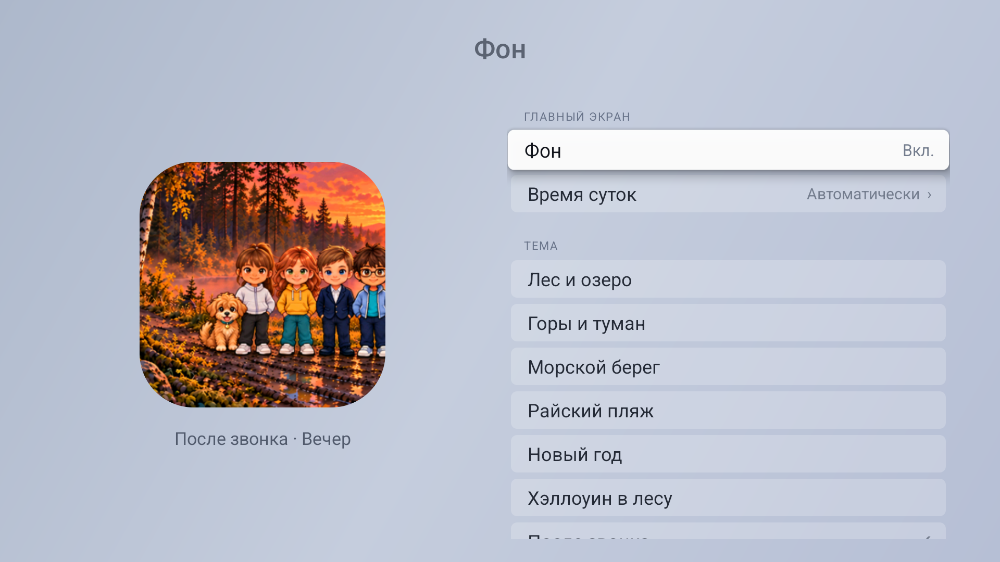
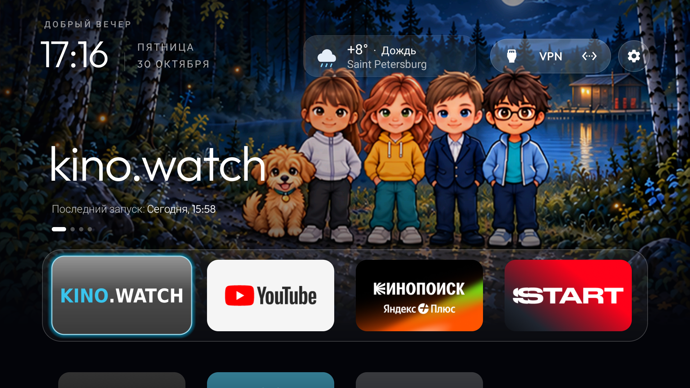
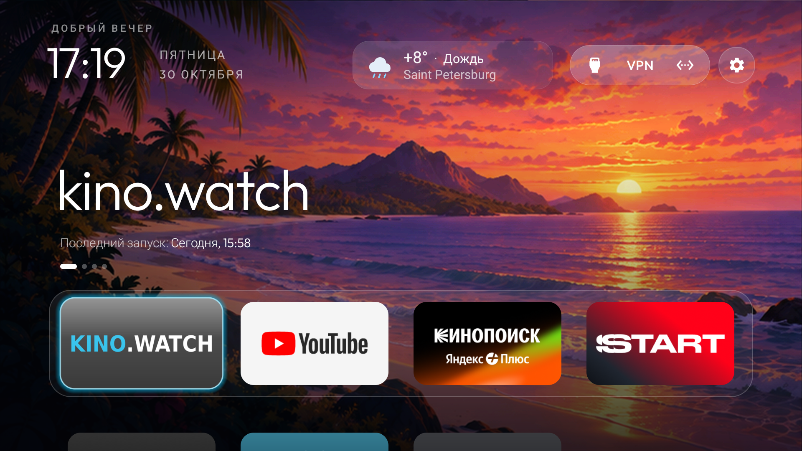
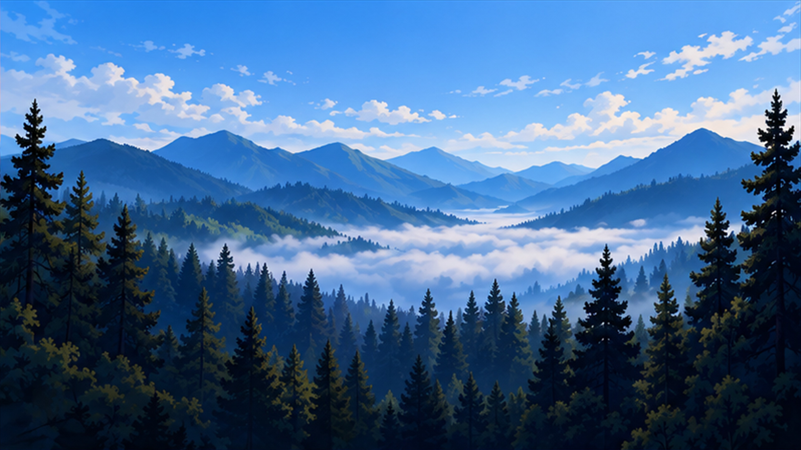
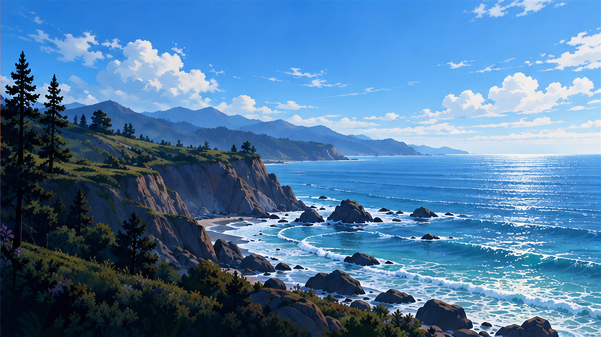
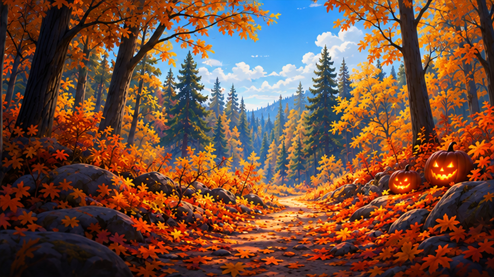
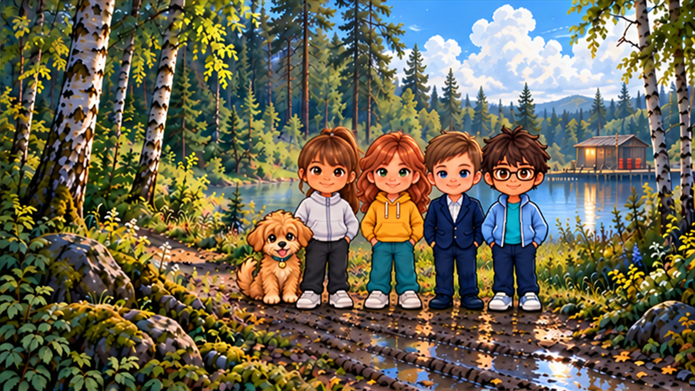

# Темы фона

[Русский](BACKGROUNDS.md) | [English](BACKGROUNDS.en.md)

Реализовано в версии 3.4. Откройте **Настройки → Фон**. Вкл. показывает выбранную сцену; Выкл. возвращает прежнее оформление Home. Выбор сохраняется при обновлении APK. На новом телевизоре по умолчанию Выкл. Положение плиток и заставка ожидания сохраняются.

**Время суток:** Автоматически — по местным часам ТВ: утро 06–11, день 11–17, вечер 17–22, ночь 22–06. Можно выбрать фиксированное время. Сеть и геопозиция для фонов не нужны.

## Разрешение

Все 28 установленных фоновых файлов — JPEG 3840×2160. Это качественное увеличение согласованных сгенерированных иллюстраций; новая детализация native 4К не синтезировалась. Лаунчер загружает размер под доступный экран: на 1080p — уменьшенный, при доступном Android-окне 4К — полный. Раскладка от размера файла не меняется.

На проверенном MiTV-MOEU1 панель работает в 3840×2160, а окно приложений — в 1920×1080. При первой проверке `config_maxUiWidth` был равен 1920. При повторной проверке он показал 3840, а эффективный интерфейс оставался 1920×1080 с заданным системным размером. Работа интерфейса в 4К на этой модели пока не подтверждена. [Как Android рассчитывает размеры интерфейса](https://android.googlesource.com/platform/frameworks/base/+/e0f778e6a0d7/services/core/java/com/android/server/wm/DisplayContent.java)

## Масштаб на Xiaomi после перезагрузки

Этот случай проверен на Xiaomi MiTV-MOEU1 (`lalaland`). После перезагрузки панель осталась в 4К, а меню при 1920×1080 стало крупнее из-за плотности 640 dpi. Рабочий масштаб на проверенном ТВ — 320 dpi.

1. Подключитесь кнопкой «Подключить» в Windows-установщике. Откройте PowerShell и впишите IP своего ТВ в примере. Если в установщике указан другой порт, замените и порт.

   ```powershell
   $adb = Join-Path $env:LOCALAPPDATA 'TVHomeInstaller\adb-37.0.1\adb.exe'
   $tv = '192.168.1.50:5555'
   & $adb -s $tv shell getprop ro.product.model
   & $adb -s $tv shell am get-current-user
   & $adb -s $tv shell wm size
   & $adb -s $tv shell wm density
   ```

2. Выполните следующие команды, только если вывод совпал с проверенным случаем: модель `MiTV-MOEU1`, профиль `0`, физический размер `3840x2160`, заданный размер `1920x1080`, физическая плотность `320` и заданная `640`.

   ```powershell
   & $adb -s $tv shell wm density 320
   & $adb -s $tv shell settings --user 0 put secure display_density_forced 320
   & $adb -s $tv shell wm density
   & $adb -s $tv shell settings --user 0 get secure display_density_forced
   ```

После команды масштаб меняется сразу. Последняя команда должна вывести `320`. На проверенном ТВ прочитано сохранённое значение. Повторная перезагрузка после записи пока не проверена. [Как Android читает сохранённую плотность](https://android.googlesource.com/platform/frameworks/base/+/android-14.0.0_r1/services/core/java/com/android/server/wm/WindowManagerService.java)

## Реальные снимки ТВ







## Семь сцен

Ниже дневные примеры из настоящих файлов 4К. У каждой темы также есть утро, вечер и ночь в `app/src/main/assets/backgrounds`.

### Лес и озеро


### Горы и туман



### Морской берег



### Райский пляж


### Новый год


### Хэллоуин в лесу



### После звонка — Джонни рядом с Марией



Образы героев игровой темы: [After the Bell](https://afterthebellgame.com/), [App Store](https://apps.apple.com/ru/app/id6822703005).

[Задания генерации](background-production-prompts.json).
